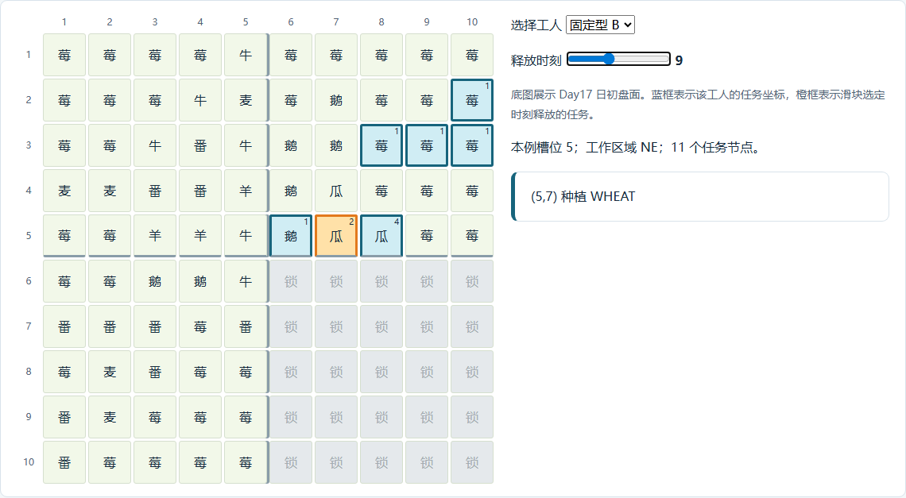

# Kaggriculture Agent：区域分工、任务链与局部决策学习

Kaggriculture 的经营决策同时受到生产周期、工人行动、材料、仓容和市场价格约束。Agent 将农民分为**区域固定型**与**区域流动型**：固定型承担稳定的空间访问和经营任务，流动型处理跨区衔接、积压与运输。经营层确定生产目标，调度层组织完整任务链，执行层根据实际状态选择动作并处理失败。

运行主控采用参数化路线、实时状态检查和局部修复。任务链学习、出售学习与作物合同实验分别研究工作链选择、交易数量和生产方案估值。

相关材料：[项目复盘](../README.md) · [全时域估值器](../720_step_value_code/README.md) · [代码示例](docs/examples.md) · [快照切片与样本](data/README.md)。

## 1. 整体决策链路

```text
读取观测：日期、商店、地块、工人位置、仓库、背包
    ↓
确定经营目标：维护期限、收获机会、再投资、终局兑现
    ↓
组织任务链：固定区域路线、跨区工作、材料与运输衔接
    ↓
核验执行条件：实际到岗、移动、资源、依赖、截止时间、仓容
    ↓
提交工人动作与市场订单
    ↓
读取新状态：识别已完成节点、更新剩余承诺、修复受影响路线
```

状态分别记录地块待收产品、每个工人的携货和仓库可售库存。现金、剩余行动数与仓容构成三类资源预算。对手供给预测依据公开盘面生成情景，私人库存作为未观测变量处理。

| 层次 | 依据的信息 | 主要决策 |
|---|---|---|
| 经营目标 | 剩余天数、商店需求、作物周期、动物生产状态 | 建设、维护、收获、再投资与终局兑现 |
| 区域路线 | 作物与动物的相对位置、仓库入口、稳定访问顺序 | 固定型工人的主要工作范围与连续任务 |
| 流动调度 | 实际位置、到岗时间、背包、剩余任务与期限 | 跨区支援、任务转交、运输与局部修复 |
| 动作执行 | 地块状态、材料、前置操作、已完成节点 | 移动、领取、种植、维护、收获与卸货 |
| 出售 | 真实仓库库存、保护储备、市场状态、入库计划 | 出售商品、数量、时点与腾仓需求 |

经营目标随阶段变化。前期完成土地扩张和种养建设；中期兼顾维护、收获补种与库存兑现；Day28 的投资计入最终收获和运输；Day29–30 集中处理能增加终局现金的工作。跨日任务依据新一天的实际盘面更新需求与期限。

## 2. 区域固定型农民

### 2.1 按空间组织连续工作

每块 5×5 区域依据动物与作物的相对位置、仓库入口和生产周期配置稳定路线。每区约三人是常见结构，人数随日期和经营分支调整。工人按实际到岗时刻逐个绑定路线并开始工作。

固定型工人的一条路线可以同时经过动物格、作物格和仓库入口。例如在动物格收肥后沿途施肥，收麦后沿途喂养，短作物收获后接续补种和浇水。这些衔接利用同一工人的背包和行进方向，减少领取材料和重复访问地块的成本。

三个区域按空间组织路线，操作类型随沿途地块变化。Day17 的代表性衔接为：

| 区域 | 固定路线的组织方式 | 坐标链示例 |
|---|---|---|
| 左上 NW | 沿靠近中线的动物带领取与收集材料，再接外围作物 | (5,5) 领取饲料 → (4,5) 喂养、照料、收肥 → (3,5) 收肥 → (2,5) 施肥、浇水 → (1,5) 动物维护 → 沿 (1,4) 至 (1,1) 处理作物 |
| 右上 NE | 近仓收获返仓，接续短作物补种，再向外侧收获带推进 | (5,8) 浇水收瓜 → (5,6) 卸货 → (5,7)、(5,8) 补种浇水 → (3,8)、(3,9)、(3,10)、(2,10) 收获 |
| 左下 SW | 从近仓动物节点向下延伸，利用沿途肥料与剩余访问处理作物 | (6,5)、(6,4) 动物维护与收肥 → (7,4)、(8,4) 浇水 → (9,2) 施肥浇水 → (9,1)、(8,1)、(8,2) 接续维护 |

固定路线之间以已完成节点衔接，流动工人保留跨区的完整前后缀。区域人数按当日作物阶段、收获量和维护期限配置。

路线包含坐标、操作顺序、最早释放时间、期限和材料需求。种植动作配置默认作物参数；调整作物时同步核对后续维护、收获日期、收后状态和出售安排。

### 2.2 Day17 的三条固定路线与跨区衔接

下图以 10×10 地块展示 Day17 日初盘面。坐标采用**（行，列），从 1 开始**。蓝框为选定工人的任务坐标，橙框为 hour9 释放的种植节点；底图保持日初状态。



| 工人 | 主要工作范围 | 任务链 |
|---|---|---|
| 固定型 A | 右上近仓作物与动物带 | 在 (5,7) 浇水、收瓜 → 到 (5,6) 卸货 → 领取饲料 → 沿动物格喂养、照料、收肥和收获 |
| 固定型 B | 右上近仓作物与右侧草莓带 | 在 (5,8) 浇水、收瓜 → 返仓 → 在 (5,7)、(5,8) 补种浇水 → 沿右侧草莓带收获 |
| 固定型 C | 右上内侧作物与外圈草莓 | 在 (4,7) 浇水、收瓜 → 返仓并处理沿途动物产物 → 回到 (4,7) 补种浇水 → 沿外圈草莓收获 |
| 流动型 D | 右上至左上 | 领取饲料 → 完成右上动物维护 → 在左上 (3,3) 收肥 → 到 (3,2) 施肥、浇水 |

A 的收获为 B 的补种释放地块；D 在 (3,6) 完成喂养，A 接续照料。固定路线和流动路线通过这些节点的完成状态衔接。

<details>
<summary>Day17 的 0–23 turns 任务表</summary>

表中时间为任务的最早释放时刻。空白表示该时刻没有新释放节点，工人仍可移动、执行先前节点或等待。实际执行时间随到岗时刻与现场状态调整。

| hour | 固定型 A | 固定型 B | 固定型 C | 流动型 D |
|---:|---|---|---|---|
| 0 | — | — | — | — |
| 1 | — | — | — | (6,6) 领取小麦 3 |
| 2 | (5,7) 浇水 | — | — | — |
| 3 | (5,7) 收获 | (5,8) 浇水 | — | (5,6) 喂养 |
| 4 | — | (5,8) 收获 | (4,7) 浇水 | (5,6) 照料 |
| 5 | (5,6) 卸货 | — | (4,7) 收获 | — |
| 6 | (5,6) 收肥 | — | — | (4,6) 收肥 |
| 7 | (5,6) 收获 | (5,6) 卸货 | — | (4,6) 喂养 |
| 8 | (5,6) 卸货 | — | (5,6) 卸货 | (4,6) 照料 |
| 9 | (5,6) 领取小麦 2 | (5,7) 种植小麦 | — | — |
| 10 | — | (5,7) 浇水 | (4,6) 收获 | (3,6) 收肥 |
| 11 | — | — | — | (3,6) 喂养 |
| 12 | (3,6) 照料 | (5,8) 种植小麦 | (4,7) 种植小麦 | — |
| 13 | — | (5,8) 浇水 | (4,7) 浇水 | — |
| 14 | (3,7) 喂养 | — | — | — |
| 15 | (3,7) 收肥 | — | — | (3,3) 收肥 |
| 16 | (3,7) 照料 | (3,8) 收获 | — | — |
| 17 | — | — | (2,8) 收获 | (3,2) 施肥 |
| 18 | (2,7) 喂养 | (3,9) 收获 | — | (3,2) 浇水 |
| 19 | (2,7) 照料 | — | (1,8) 收获 | — |
| 20 | (2,7) 收肥 | (3,10) 收获 | — | — |
| 21 | (2,7) 收获 | — | (1,9) 收获 | — |
| 22 | — | (2,10) 收获 | — | — |
| 23 | — | — | (1,10) 收获 | — |

</details>

## 3. 区域流动型农民

流动型工人承担完整的跨区任务链。路线成本包括从实际位置出发的移动、领取材料、执行操作、必要返仓及后续承诺。工人在一块地收集的肥料或粮食，可以作为下一块地的投入；调度器统一维护这条路线的材料归属和可用时间。

日初根据任务量和到岗情况分配路线。执行过程中，工人空闲、材料变化、节点失效或预计超期时触发局部修复，修复范围限定为受影响任务及其依赖。

### 辅助收获与运输

当 A 协助 B 收获时：

1. 将指定的 HARVEST 节点交给 A，保留 B 在该格的喂养、照料、收肥或补种任务。
2. 收获进入 A 的背包，返仓距离、卸货时刻和仓容需求按 A 的真实位置计算。
3. B 到场后根据实时状态跳过已完成收获，继续剩余链。
4. 重算 B 释放时间后的可行工作，比较新增任务和原有承诺。

候选收益由三部分组成：避免溢出或提前兑现的收益、B 新增完成工作的收益，以及绕行和任务干扰成本。B 的新增工作收益可以为零，及时运输本身可以构成有效改进。

## 4. 技能执行、目标判断与失败处理

技能以完整任务链表示，包含前置条件、动作序列和完成状态。例如空地补种链为：

```text
确认前序收获完成
    → 有杂草时执行 DIG
    → 核对种子与种植条件
    → PLANT
    → WATER
    → 核验地块状态并释放后续承诺
```

| 现场情况 | 执行处理 | 继续维护的信息 |
|---|---|---|
| 目标已被其他工人收获 | 跳过该次 HARVEST，执行同格后续节点 | 喂养、照料、收肥、浇水和补种承诺 |
| 杂草阻塞种植 | 在可行时间内除草，再接续原种植任务 | 作物参数、种子和浇水节点 |
| 材料未到账或已被使用 | 等待可靠到货、安排领取或局部转交 | 共享材料预约、实际背包和依赖关系 |
| 新工人迟到 | 已到岗工人持续执行，新工人接剩余链 | 实际到岗时间与剩余行动量 |
| 返仓存在溢出风险 | 提前出售腾仓，或调整运输批次 | 卸货前仓容、货物所在背包和可售库存 |
| 任务跨日积压 | 根据实际盘面更新剩余任务与期限 | 延期长度、产量影响和失败原因 |

运行执行器对部分 ready 动作在发出时推进队列，后续通过状态检查和局部修复处理偏差。反馈执行器实验采用“发出动作 → 读取新观测 → 确认完成”的顺序，在收到完成状态后推进节点，失败时保留原任务。

目标评价同时记录承诺完成率、机会覆盖率、延期、产出与实际收入。机会覆盖率衡量当前可收获、可补种机会的完成比例；承诺完成率衡量已接任务的执行可靠性。两者共同反映任务选择和执行质量。

## 5. 作物 EV 与生命周期合同

运行主控根据区域经营程序确定作物参数。独立经营估值模块按生物机制推演收获和到仓时间，再结合商品供需、逐件交易价格与投入费用计算边际收益。

作物合同模型将经济选择与后续运营要求组合起来：

| 合同内容 | 对调度的要求 |
|---|---|
| 种植、维护与收获日期 | 在对应日期保留区域访问和操作时间 |
| 收获后的地块状态 | 为清理、补种或后续持续生产安排节点 |
| 饲料、肥料、种子和资金 | 结合真实库存与到货时间预约材料 |
| 日内运输和卸货 | 计入返仓距离、卸货时刻与仓容压力 |
| 最后兑现时刻 | 在终局前完成收获、入库和出售 |

候选先经过可行性核验，再比较以下分数：

```text
合同分数 = 预计出售收入
         − 种子与材料费用
         − 劳动和运输的机会成本
```

现金净额与劳动计价分数分别记录，留空作为零新增投入的候选。

小麦与胡萝卜可以评估相近的短周期访问安排。番茄和草莓需要完整覆盖后续维护与连续收获。调整作物时，出售层同步根据实际商品和库存生成订单。

合同算例使用官方单格生物函数和逐件价格函数，市场库存设为基准 −40、基准、基准 +40 三种常量情景，采用每日浇水、每日边际移动 2 turns、劳动机会成本 3/turn。在 Day17 仅承诺访问至 Day20 的条件下，番茄后续维护缺少访问；开放后续访问后，劳动成本仍使胡萝卜在该算例中得分更高。Day28 远角落的短作物合同因最终劳动和运输期限约束而选择留空。

### 生物机制对任务安排的影响

肥料在施肥当天及之后两天有效。增产、浇水和缺水计数分别结算，合同分别安排施肥与浇水，并核算增产收益。

动物产品在容量上限内累计。收获时点依据当前存量、下一次产出、沿途运输和出售窗口确定。动物日切先结算下一日生产，再累计当天照料加成，因此 Day29 新增照料加成进入 Day30 生产之后的周期；Day29 喂养可以使此前积累的加成参与最后一轮生产。

Day30 在成熟窗口内给小麦、胡萝卜和西瓜浇水可以即时增产。收尾任务因此按具体作物状态筛选，并将运输、卸货和出售接到收获之后。

## 6. 流动农民的任务链学习

任务链实验使用表格 Q-learning。状态包括时间、位置、已完成任务、材料、携货和可见任务价值；动作对应下一条完整任务链。

启发式先计算移动、操作、剩余必要任务与最终返仓时间，生成可行动作集合。Q 表学习集合内各候选的预期收入，未见状态回退到启发式选择。

```text
实际状态 → 枚举任务链 → 材料与期限核验 → 可行动作集合
                                           ↓
                                      Q 表选择任务链
                                           ↓
                              执行、观察耗时与收入、更新价值
```

多 turn 任务采用持续时间感知的价值更新：

$$
Q(s,a)\leftarrow Q(s,a)+\alpha\left[r+\gamma^{\Delta t}\max_{a'\in\mathcal A(s')}Q(s',a')-Q(s,a)\right]
$$

其中，$\mathcal A(s')$ 为下一状态的可行动作集合，$\Delta t$ 为任务持续时间。有限期现金实验取 $\gamma=1$，收入在成功兑现时计入一次。

训练从随机生成的短场景开始，在可行动作集合内进行探索，探索概率由 30% 逐步降至 5%。每次执行后，用本次收入与后续可行动作的最高 Q 值更新当前选择，随着重复访问次数增加降低学习率。这样，返仓时获得的收入可以逐步传回此前的收获与路线选择。

评估时冻结 Q 表，按最高 Q 值选择任务链；未见状态使用启发式，Q 值相同时也按启发式选择。训练与评估入口见 [train_demo.py](examples/train_demo.py)，状态、约束和更新逻辑见 [rl_core.py](examples/rl_core.py)。

### 实验设置与结果

实验包含一个流动工人、五条候选链和 17-turn 时域。候选覆盖喂养照料、到期浇水、近仓辅助收获、远处收获和除草收获；返仓选项合并运输、卸货与成功出售。训练运行 18,000 个短场景，测试使用 400 个独立 seed，从相同的 18 种任务结构参数分布采样。

| 对照 | 配对收入差均值 | 中位数 | P10 | 最低差 | 提高 / 持平 / 降低 |
|---|---:|---:|---:|---:|---:|
| Q-learning − 启发式 | +1.1625 | 0 | 0 | 0 | 69 / 331 / 0 |

两种方法均完成必要任务并兑现全部携货。收益改善集中在部分任务价值组合，中位数保持一致。

## 7. 出售时机与数量学习

运行出售层依据经营程序确定商品和时点，并按真实仓库库存及保留目标调整数量。Day30 通过终局清仓处理剩余货物。

出售学习实验将交易数量作为动作，候选包括持有、最低腾仓量、约一半和全部可交易余量。安全层先从实际仓库库存中扣除已承诺投入，再根据下一批入库压力确定出售下限。

状态包括当前时刻、仓库库存、市场库存档位、需求强度、公开供给信号和我方入库计划。奖励取本次实际成交收入；持有动作的价值来自后续出售收入。训练沿用任务链实验的探索与 Q 值更新流程，终局出售剩余可交易库存，使各次奖励之和对应整段交易收入。

仓容按卸货发生时的状态计算。官方 DROP 将超出仓容的货物丢弃，因此腾仓需要安排在相应卸货之前。出售收入逐件计算，每件货物改变市场供给和后续价格。

### 事件驱动扩展

事件驱动方案在货物到账、生产与运输计划变化、市场库存与报价变化、商店消费与刷新、对手公开供给信号、资金缺口和运输截止时重估出售选择。

每 turn 检查资金与仓容。等待计划保存承诺数量、目标事件、最迟退出时刻和失效条件，到期或条件变化时执行清算或重新决策。对手成熟量作为供给情景输入，早卖、晚卖和部分出售分别影响候选收益。

### 实验设置与结果

出售实验采用单商品、8 个市场 tick 和线性价格模型，保护一次 2 单位生产投入。每 tick 按入库、出售、需求消耗的顺序结算，前一 tick 的出售为后续卸货预留容量。对手出货由模拟器生成，策略输入包含带噪声的公开供给信号。终局按逐件交易结果清算余货。

训练运行 30,000 个短场景；400 个独立测试 seed 对各策略使用相同初始条件和外部供给事件。

| 对照 | 配对收入差均值 | 中位数 | P10 | 最低差 | 提高 / 持平 / 降低 |
|---|---:|---:|---:|---:|---:|
| Q-learning − 及时出售 | +46.785 | +39 | +26 | +17 | 400 / 0 / 0 |
| Q-learning − 信号启发式 | +32.3675 | +31 | −22 | −30 | 310 / 0 / 90 |

各策略均保持生产投入、入库容量和最终清算要求。相对信号启发式，学习策略提高了平均收入与中位数，22.5% 的样本收入降低，配对差 P10 为 −22。策略评价同时保留平均收益、主体表现和下尾分布。

## 8. 验证与结论

机制与执行检查覆盖 13 项内容：施肥与缺水、即时增产、终局动物加成、同类动物批量领取、DROP 溢出、逐件交易压价、长周期合同、杂草修复、辅助收获后的任务保留、共享材料预约、期限与兑现、出售储备与容量，以及对手隐藏信息隔离。

区域固定路线通过稳定访问顺序和沿途材料利用组织基础经营；流动路线通过跨区衔接与有限转交处理剩余任务。作物合同将后续维护和运输纳入经济选择，反馈执行器依据实际状态维护任务连续性。

短场景实验中，任务链学习的改进集中在部分价值组合；出售学习提高了平均收入，同时呈现相对启发式的下尾损失。整局对照方案分别冻结生产、调度和出售模块，逐项评估现金、维护、运输、溢出及决策耗时，以识别各模块的收益来源。

